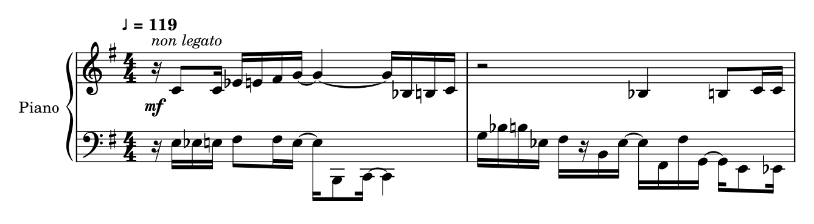

# EtuSchlopf

**Mach aus deiner Einspielung Klaviernoten. Zwei Dateien genügen.**

EtuSchlopf ist für Musikerinnen und Musiker. Ob Etüde, Song oder eigene Komposition, spielt dabei keine Rolle.

- `Mein Stück.mid` liefert die gespielten Noten und ihr Timing.
- `Mein Stück.wav` enthält den hörbaren Klang derselben Einspielung und dient als Audioreferenz.

Leg beide Dateien in denselben Ordner und zieh die MIDI-Datei auf EtuSchlopf. **Das war’s.** EtuSchlopf verwendet seine Voreinstellungen. Du bekommst ein PDF zum Lesen, Teilen und Ausdrucken und eine MusicXML-Datei zum Weiterbearbeiten in MuseScore.

Der Name darf dich zum Schmunzeln bringen. Die Mathematik dahinter nehmen wir ernst. Probier EtuSchlopf mit deinem eigenen Stück aus oder schau dir an, wie es arbeitet. [Die Mathematik hinter EtuSchlopf](docs/MATHEMATIK.md)

**[Windows-EXE herunterladen · Testversion r1684](https://github.com/Funcry241/EtuSchlopf/releases/download/v0.10.1839-r1684-windows-preview/EtuSchlopf-Windows-x64.exe)**

Windows x64 · kein Rust oder Cargo erforderlich · MuseScore für PDF · MIDI und WAV als Eingabe

[Versionshinweise und Prüfsumme](https://github.com/Funcry241/EtuSchlopf/releases/tag/v0.10.1839-r1684-windows-preview) ·
[Erstes Stück](#dein-erstes-stück) · [Grenzen der Testversion](#aktueller-stand) ·
[Technische Dokumentation](docs/DEVELOPMENT.md) · [Mathematik dahinter](docs/MATHEMATIK.md)

> **In English:** EtuSchlopf turns a matching MIDI and WAV pair into piano sheet music: a PDF and a MusicXML file for further editing in MuseScore. The Windows x64 preview needs no installation besides [MuseScore](https://musescore.org/download) for the PDF. The documentation is in German; bug reports and questions in English are welcome.

## Ein Blick auf die Noten

*Etüde Nr. 1 aus dem nativen r1684-Lauf. Bild anklicken für die vollständige PDF.*

Das Projekt ist experimentell und privat gepflegt. Prüfe am eigenen Stück,
ob dir die Fassung bei der weiteren Arbeit hilft. Musikalische Nachbearbeitung
kann erforderlich sein.

## Dein erstes Stück

**[Kleines Startbeispiel herunterladen](https://github.com/Funcry241/EtuSchlopf/releases/download/v0.10.1839-r1684-windows-preview/EtuSchlopf-Beispiel-r1684.zip)** – synthetisches MIDI/WAV-Paar mit der PDF, die die veröffentlichte r1684-EXE daraus erzeugt hat.

1. Lade die Windows-EXE herunter. Für die PDF-Ausgabe brauchst du außerdem **[MuseScore](https://musescore.org/de/download)**.
2. Lege MIDI und WAV in denselben Ordner. Die Namen vor der Dateiendung müssen übereinstimmen: `Mein Stück.mid` und `Mein Stück.wav`.
3. Ziehe deine `.mid`- oder `.midi`-Datei auf die EXE. Alternativ startest du die EXE und gibst den Pfad zur MIDI-Datei ein.
4. Öffne nach erfolgreichem Lauf die PDF im angezeigten Ergebnisordner. Zum Weiterbearbeiten öffnest du die Datei mit `.render.musicxml` in MuseScore.

Du brauchst für diesen Weg keinen Repository-Download und keine Rust-Installation.
Wähle für den ersten Versuch ein kurzes Stück, dessen Noten du kennst. So kannst
du das Ergebnis leichter beurteilen.

Neben deiner MIDI entsteht der Ordner **`EtuSchlopf-Ergebnisse`**. Jeder Lauf
bekommt darin einen neuen Unterordner. Das Programm arbeitet mit Kopien deiner
Eingaben; Originaldateien und frühere Laufordner bleiben erhalten.

## Deine Ergebnisse

| Du möchtest … | Öffne … |
| --- | --- |
| die Noten lesen oder ausdrucken | `Mein Stück.pdf` |
| die Noten in MuseScore bearbeiten | `Mein Stück.render.musicxml` |
| eine Fehlermeldung genauer nachvollziehen | `Mein Stück.result.txt`, sofern der Lauf einen Bericht erzeugt hat |

Für die Bearbeitung in MuseScore ist die Datei mit **`.render.musicxml`** die
richtige Wahl. Weitere technische Dateien können im Ergebnisordner liegen.

## Wenn der Start nicht klappt

- **WAV fehlt:** Lege eine echte gleichnamige WAV-Datei neben die MIDI. MIDI ohne WAV wird derzeit noch nicht unterstützt.
- **Keine PDF:** Prüfe, ob MuseScore installiert ist. Mit `EtuSchlopf-Windows-x64.exe "Mein Stück.mid" --no-pdf` kannst du nur die Notendateien anfordern.
- **Datei wird abgelehnt:** Das kann an einer Grenze oder einem Fehler von EtuSchlopf liegen und bedeutet nicht automatisch, dass deine MIDI fehlerhaft ist. Du musst die Ursache nicht selbst herausfinden. Den Wortlaut der Meldung kannst du im [Fehlerbericht](https://github.com/Funcry241/EtuSchlopf/issues/new?template=01_fehler.md) angeben.
- **Lauf fehlgeschlagen:** Frühere Ergebnisordner bleiben bestehen. Eine Datei aus einem fehlgeschlagenen Lauf ist noch kein freigegebenes Ergebnis.

## Eine falsche Note oder einen Fehler melden

**[Fehlerbericht öffnen](https://github.com/Funcry241/EtuSchlopf/issues/new?template=01_fehler.md)**

Beschreibe, was du versucht hast und was passiert ist. Bei einem Notationsfehler
hilft zum Beispiel: „In Takt … fehlt …; ich erwarte …“ Ein Bildausschnitt ist
willkommen. Du musst dafür keinen Quellcode verstehen und keinen vollständigen
Laufbericht zusammentragen. Unbekannte technische Angaben kannst du offenlassen.

## Aktueller Stand

Die Windows-Testversion enthält **Engine r1684 / 0.10.1839** und den verbesserten
Starter. Unterstützt sind 2/4, 3/4 und 4/4 sowie Taktwechsel an Taktgrenzen.
Andere Taktarten, Triolen und Wechsel mitten im Takt bleiben nicht unterstützt.

Windows-Build, Pakettests, isolierter Start ohne Entwickler-PATH und ein frisch
gerendertes PDF-Startbeispiel sind bestanden. Strict-Clippy und native Tests
sind im angenommenen Entwicklungslauf bestanden. Der private native Korpus umfasst zehn vollständige
Etüden mit MuseScore. Die [Versionshinweise mit Prüfbelegen](https://github.com/Funcry241/EtuSchlopf/releases/tag/v0.10.1839-r1684-windows-preview)
beschreiben den Umfang. Das ersetzt keine unabhängige Bewertung fremder Stücke
und keinen interaktiven Anwender-Probelauf. Lesbarkeit und Spielbarkeit prüfst
du am eigenen Ergebnis.

## Quellstand und Beiträge

Der Entwicklungsquellstand ist **r1684 / 0.10.1839**. Der vollständige native Korpuslauf mit zehn Etüden wurde angenommen: Build und Strict-Clippy bestanden, 2992 Tests bestanden, vier ignoriert. [Native Abnahme r1684](docs/evidence/r1684/README.md). Dieser Stand enthält die Weiterentwicklung seit r1659 einschließlich der C3-Behandlung ursprünglicher Pausenanker und der Verbesserungen an der Watch-Webansicht. Die [Mathematik-Seite](docs/MATHEMATIK.md) beschreibt 34 Verfahrensfamilien und trennt produktive Entscheidungen, Audits, historische Modelle und offene Grenzen. r1684 selbst aktualisiert die Dokumentation auf dem Laufzeitstand r1683. Die Windows-Testversion und das herunterladbare Startbeispiel verwenden ebenfalls r1684. Der oben abgebildete Korpusausschnitt stammt ebenfalls aus dem angenommenen nativen r1684-Lauf.

Die Download-Engine wurde aus dem angenommenen nativen Stand **r1684** gebaut.
Der [zum geprüften Build gehörende r1684-Quellbaum](https://github.com/Funcry241/EtuSchlopf/releases/download/v0.10.1839-r1684-windows-preview/EtuSchlopf-r1684-source.zip)
und das Dateiprüfsummen-Manifest stehen beim Release bereit. Für den exakten
Engine-Build ist dieser Snapshot maßgeblich; der zugehörige Prüfzweig enthält
den Starter und die Skripte zur vollständigen Rekonstruktion und Verifikation.

Für die Arbeit am Quellcode gelten die [technische Referenz](docs/DEVELOPMENT.md)
und die [Beitragsregeln](docs/CONTRIBUTING.md). Der [Dokumentationswegweiser](docs/README.md)
führt zu Architektur, Diagnose und Community-Dateien. Welche Mathematik EtuSchlopf
wo einsetzt und was davon das Notenbild verändert, beschreibt die
[Mathematik-Seite](docs/MATHEMATIK.md).

Fehlerberichte sind willkommen. Bitte nenne die verwendete Version, die konkrete
Meldung und – bei einem Notationsfehler – die betroffene Stelle.
[Beiträge](docs/CONTRIBUTING.md) · [Sicherheit](docs/SECURITY.md) ·
[Umgang miteinander](docs/CODE_OF_CONDUCT.md) · [Barrierefreiheit](docs/ACCESSIBILITY.md)

## Lizenz

EtuSchlopf steht unter der [MIT-Lizenz](LICENSE).
[Fremdkomponenten und Lizenzen](docs/THIRD_PARTY_NOTICES.md).

