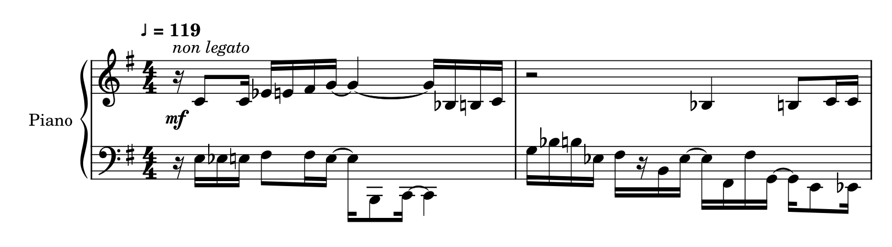

# EtuSchlopf

**Klaviernoten aus zusammengehörigen MIDI- und WAV-Dateien – als PDF und zum Bearbeiten in MuseScore.**

EtuSchlopf ordnet musikalische Ereignisse zu einer zweihändigen Klavierdarstellung
und bearbeitet unter anderem Stimmen, Rhythmus, Pausen, Balken und Register.
Das Ergebnis ist ein Ausgangspunkt für deine weitere musikalische Arbeit.

**[Windows-EXE herunterladen · Testversion r1537](https://github.com/Funcry241/EtuSchlopf/releases/download/v0.10.1839-r1537-windows-preview/EtuSchlopf-Windows-x64.exe)**

Windows x64 · kein Rust oder Cargo erforderlich · MuseScore für PDF · MIDI und WAV als Eingabe

[Versionshinweise und Prüfsumme](https://github.com/Funcry241/EtuSchlopf/releases/tag/v0.10.1839-r1537-windows-preview) ·
[Erstes Stück](#dein-erstes-stück) · [Grenzen der Testversion](#aktueller-stand) ·
[Technische Dokumentation](docs/DEVELOPMENT.md)

## Ein Blick auf die Noten

[](docs/examples/etude-1-r1537.pdf)

*Etüde Nr. 1 aus dem eigenen Evaluationskorpus: unveränderter PDF-Ausschnitt,
Entwicklungsstand r1537. Bild anklicken für die vollständige PDF.
Die aktuelle Download-EXE enthält ebenfalls die Engine r1537.*

## Für wen ist EtuSchlopf gedacht?

Für Menschen, die zu einem Stück eine MIDI-Datei und eine passende WAV-Datei
besitzen und daraus eine Klavierfassung zum Lesen und Weiterbearbeiten gewinnen
möchten. MIDI liefert die Notenereignisse und ihre Zeitstruktur; WAV steht als
Klangaufnahme für die Audio-Beobachtung zur Verfügung. Beide Dateien werden
im derzeitigen Ablauf benötigt.

Das Projekt ist experimentell und privat gepflegt. Prüfe am eigenen Stück,
ob dir die Fassung bei der weiteren Arbeit hilft; musikalische Nachbearbeitung
kann erforderlich sein.

## Dein erstes Stück

**[Kleines Startbeispiel herunterladen](https://github.com/Funcry241/EtuSchlopf/releases/download/v0.10.1839-r1537-windows-preview/EtuSchlopf-Beispiel-r1537.zip)** – synthetisches MIDI/WAV-Paar mit der zugehörigen PDF aus dem Windows-Test.

Du brauchst eine MIDI-Datei und eine gleichnamige WAV-Datei, zum Beispiel:

```text
Mein Stück.mid
Mein Stück.wav
```

1. Lade die Windows-EXE herunter. Für die PDF-Ausgabe brauchst du außerdem **[MuseScore](https://musescore.org/de/download)**.
2. Lege MIDI und WAV in denselben Ordner. Die Namen vor der Dateiendung müssen übereinstimmen: `Mein Stück.mid` und `Mein Stück.wav`.
3. Ziehe deine `.mid`- oder `.midi`-Datei auf die EXE. Alternativ startest du die EXE und gibst den Pfad zur MIDI-Datei ein.
4. Öffne nach erfolgreichem Lauf die PDF im angezeigten Ergebnisordner. Zum Weiterbearbeiten öffnest du die Datei mit `.render.musicxml` in MuseScore.

Du brauchst für diesen Weg keinen Repository-Download und keine Rust-Installation.
Wähle für den ersten Versuch ein kurzes Stück, dessen Noten du kennst. So kannst
du das Ergebnis leichter beurteilen.

Neben deiner MIDI entsteht der Ordner **`EtuSchlopf-Ergebnisse`**. Jeder Lauf
bekommt darin einen neuen Unterordner. Das Programm arbeitet mit Kopien deiner
Eingaben; Originaldateien und frühere Laufordner bleiben erhalten.

## Deine Ergebnisse

| Du möchtest … | Öffne … |
| --- | --- |
| die Noten lesen oder ausdrucken | `Mein Stück.pdf` |
| die Noten in MuseScore bearbeiten | `Mein Stück.render.musicxml` |
| eine Fehlermeldung genauer nachvollziehen | `Mein Stück.result.txt`, sofern der Lauf einen Bericht erzeugt hat |

Für die Bearbeitung in MuseScore ist die Datei mit **`.render.musicxml`** die
richtige Wahl. Weitere technische Dateien können im Ergebnisordner liegen.

## Wenn der Start nicht klappt

- **WAV fehlt:** Lege eine echte gleichnamige WAV-Datei neben die MIDI. MIDI ohne WAV wird derzeit noch nicht unterstützt.
- **Keine PDF:** Prüfe, ob MuseScore installiert ist. Mit `EtuSchlopf-Windows-x64.exe "Mein Stück.mid" --no-pdf` kannst du nur die Notendateien anfordern.
- **Datei wird abgelehnt:** Das kann an einer Grenze oder einem Fehler von EtuSchlopf liegen und bedeutet nicht automatisch, dass deine MIDI fehlerhaft ist. Du musst die Ursache nicht selbst herausfinden. Den Wortlaut der Meldung kannst du im [Fehlerbericht](https://github.com/Funcry241/EtuSchlopf/issues/new?template=01_fehler.md) angeben.
- **Lauf fehlgeschlagen:** Frühere Ergebnisordner bleiben bestehen. Eine Datei aus einem fehlgeschlagenen Lauf ist noch kein freigegebenes Ergebnis.

## Eine falsche Note oder einen Fehler melden

**[Fehlerbericht öffnen](https://github.com/Funcry241/EtuSchlopf/issues/new?template=01_fehler.md)**

Beschreibe, was du versucht hast und was passiert ist. Bei einem Notationsfehler
hilft zum Beispiel: „In Takt … fehlt …; ich erwarte …“ Ein Bildausschnitt ist
willkommen. Du musst dafür keinen Quellcode verstehen und keinen vollständigen
Laufbericht zusammentragen. Unbekannte technische Angaben kannst du offenlassen.

## Aktueller Stand

Die Windows-Testversion enthält **Engine r1537 / 0.10.1839** und den verbesserten
Starter. Unterstützt sind 2/4, 3/4 und 4/4 sowie Taktwechsel an Taktgrenzen.
Andere Taktarten, Triolen und Wechsel mitten im Takt bleiben nicht unterstützt.

Der Windows-Build, Strict-Clippy, native Tests und ein vollständiger synthetischer
MIDI/WAV-Lauf mit MuseScore sind bestanden. Die [Versionshinweise mit Prüfbelegen](https://github.com/Funcry241/EtuSchlopf/releases/tag/v0.10.1839-r1537-windows-preview)
beschreiben den Umfang. Das ersetzt keine unabhängige Bewertung fremder Stücke
und keinen interaktiven Anwender-Probelauf. Lesbarkeit und Spielbarkeit prüfst
du am eigenen Ergebnis.

## Quellstand und Beiträge

Die Download-Engine wurde aus dem angenommenen nativen Stand **r1537** gebaut.
Der [exakte r1537-Quellbaum](https://github.com/Funcry241/EtuSchlopf/releases/download/v0.10.1839-r1537-windows-preview/EtuSchlopf-r1537-source.zip)
und das Dateiprüfsummen-Manifest stehen beim Release bereit. Für den exakten
Engine-Build ist dieser Snapshot maßgeblich; der zugehörige Prüfzweig enthält
den Starter und die Skripte zur vollständigen Rekonstruktion und Verifikation.

Für die Arbeit am Quellcode gelten die [technische Referenz](docs/DEVELOPMENT.md)
und die [Beitragsregeln](docs/CONTRIBUTING.md). Der [Dokumentationswegweiser](docs/README.md)
führt zu Architektur, Diagnose und Community-Dateien.

Fehlerberichte sind willkommen. Bitte nenne die verwendete Version, die konkrete
Meldung und – bei einem Notationsfehler – die betroffene Stelle.
[Beiträge](docs/CONTRIBUTING.md) · [Sicherheit](docs/SECURITY.md) ·
[Umgang miteinander](docs/CODE_OF_CONDUCT.md) · [Barrierefreiheit](docs/ACCESSIBILITY.md)

## Lizenz

EtuSchlopf steht unter der [MIT-Lizenz](LICENSE).
[Fremdkomponenten und Lizenzen](docs/THIRD_PARTY_NOTICES.md).

