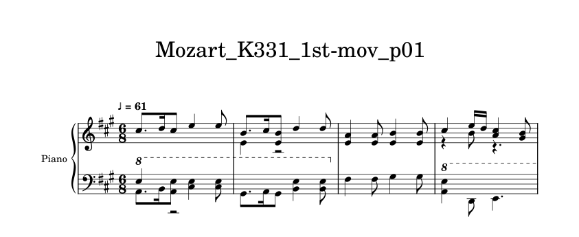
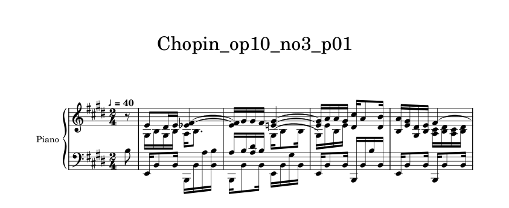

# EtuSchlopf

**EtuSchlopf macht Klaviernoten aus deiner Einspielung.** Aus der MIDI-Datei und der zugehörigen WAV-Aufnahme erstellt EtuSchlopf ein Noten-PDF und MusicXML für die Weiterbearbeitung in MuseScore. Bei frei gespielten Aufnahmen leitet es Takt und Notenwerte aus der Einspielung ab.

## Dein erstes Stück

1. Lade die **Windows-EXE für x64** herunter. Für die PDF-Ausgabe brauchst du MuseScore. [EtuSchlopf-Windows-x64.exe](https://github.com/Funcry241/EtuSchlopf/releases/download/v0.10.1839-r1965-windows-preview/EtuSchlopf-Windows-x64.exe) · [MuseScore](https://musescore.org/de/download)
2. Lege `Mein Stück.mid` und `Mein Stück.wav` in denselben Ordner. Beide Dateien müssen zur selben Einspielung gehören. Zum Ausprobieren kannst du das fertige MIDI/WAV-Paar entpacken. [Startbeispiel als ZIP](https://github.com/Funcry241/EtuSchlopf/releases/download/v0.10.1839-r1965-windows-preview/EtuSchlopf-Beispiel-r1965.zip)
3. Ziehe die MIDI-Datei auf die EXE. Du kannst die EXE auch öffnen und den Pfad zur MIDI eingeben.
4. Öffne im neuen Laufordner unter `EtuSchlopf-Ergebnisse` das PDF. Für die Weiterbearbeitung in MuseScore öffnest du die `.render.musicxml`. Verwendet der PDF-Export direkt den Master, öffnest du die `.musicxml`.

Der Ergebnisordner liegt neben der MIDI. EtuSchlopf arbeitet dort mit Kopien der Eingaben. Bei einem Fehler zeigt die Konsole die Meldung. Wenn der Lauf einen Bericht geschrieben hat, findest du ihn im Laufordner als `.result.txt`. [Version und Prüfsummen](https://github.com/Funcry241/EtuSchlopf/releases/tag/v0.10.1839-r1965-windows-preview)

> **In English:** EtuSchlopf uses a matching MIDI and WAV pair to produce piano sheet music as PDF and MusicXML. The Windows x64 preview uses MuseScore for PDF export. Issues in English are welcome.

## Notenbilder

| Mozart · Sonate A-Dur KV 331 | Bach · Fuge c-Moll BWV 847 |
| --- | --- |
|  |  |
| **Chopin · Etüde E-Dur op. 10 Nr. 3** | **Schubert · Deutscher Tanz As-Dur D. 783 Nr. 15** |
|  |  |

Ein Klick auf den Ausschnitt öffnet das vollständige PDF. [Alle 14 Stücke mit Notenbildern, Druckvorlagen und Quellen aus r1965](docs/examples/README.md)

## Stand auf main

**r1965 / 0.10.1839** wurde unter Windows angenommen. Der Vollkorpuslauf verarbeitete alle 14 Stücke mit Exitcode 0 und erzeugte 14 Noten-PDFs mit insgesamt 57 Seiten. [Windows-Abnahme und Vollkorpus r1965](docs/evidence/r1965/README.md)

Bei Mozarts Andante grazioso aus KV 331 stimmen alle 474 regulären Noteneinsätze in Zeitpunkt und Tonhöhe mit der annotierten Einspielung überein. Bei 460 stimmen auch die geschriebenen Dauern. Das entspricht dem Einzellauf r1964. [Mozart-PDF r1965](docs/examples/mozart-k331-p01-r1965.pdf) · [Mathematik hinter den Notationsentscheidungen](docs/MATHEMATIK-VOLLKORPUS.md)

EtuSchlopf ist experimentell. Bleiben Einsätze oder Taktgrenzen einer frei gespielten Aufnahme mehrdeutig, kann EtuSchlopf den Lauf abbrechen. Chopins Ballade op. 38 wird separat als Stresstest geführt. [Ballade op. 38](docs/examples/chopin-op38-p01.md)

## Dokumentation und Beiträge

[Dokumentationswegweiser](docs/README.md) · [Technische Referenz](docs/DEVELOPMENT.md) · [Mitmachen](docs/CONTRIBUTING.md) · [Fehler melden](https://github.com/Funcry241/EtuSchlopf/issues/new?template=01_fehler.md)

Nenne im Fehlerbericht die Version, die Meldung und bei einem Notationsfehler die betroffene Stelle. Ein Notenausschnitt hilft bei der Zuordnung.

## Lizenz

Der Code steht unter der [MIT-Lizenz](LICENSE). Für Fremdkomponenten und Musikdateien gelten die jeweils ausgewiesenen Rechte. [Fremdlizenzen](docs/THIRD_PARTY_NOTICES.md) · [Musikquellen und Namensnennung](docs/examples/README.md#quellen-und-rechte) · [Chopin op. 38](docs/examples/chopin-op38-p01.md)
