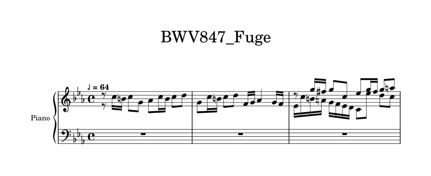
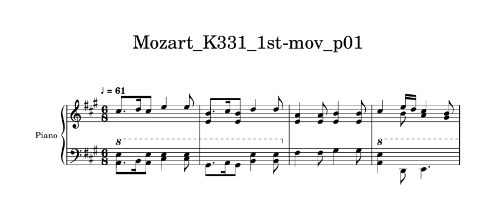
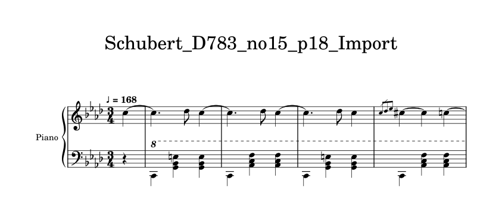

# EtuSchlopf

**EtuSchlopf macht Klaviernoten aus deiner Einspielung.** Die MIDI-Datei liefert die gespielten Noten und ihr Timing. Die gleichnamige WAV-Datei liefert die Audioaufnahme derselben Einspielung. EtuSchlopf erstellt daraus ein Noten-PDF und MusicXML zur Weiterbearbeitung in MuseScore.

## Dein erstes Stück

1. Lade die [Windows-Testversion r1933](https://github.com/Funcry241/EtuSchlopf/releases/tag/v0.10.1839-r1933-windows-preview) herunter. Für die PDF-Ausgabe installiere [MuseScore](https://musescore.org/de/download).
2. Lege MIDI und WAV in denselben Ordner. Verwende denselben Dateinamen vor der Endung, etwa `Mein Stück.mid` und `Mein Stück.wav`.
3. Ziehe die MIDI auf die EXE oder öffne die EXE und gib den Pfad zur MIDI ein.
4. Öffne das PDF im Ergebnisordner. Für Änderungen in MuseScore öffne `Mein Stück.render.musicxml` oder die Master-Datei `Mein Stück.musicxml`, wenn der PDF-Export diese direkt verwendet.

Der Windows-Download enthält r1933. Die Notengalerie und der Quellstand auf GitHub zeigen r1938. Die Testversion ist für Windows x64 und startet ohne Rust oder Cargo. Der Starter legt neben der MIDI einen neuen Laufordner unter `EtuSchlopf-Ergebnisse` an und arbeitet mit Kopien der Eingaben. Bei einem Fehler liefert die Konsole den ersten Hinweis. Ein vorhandener Ergebnisbericht trägt die Endung `.result.txt`.

> **In English:** EtuSchlopf uses a matching MIDI and WAV pair to produce piano sheet music as PDF and MusicXML. The Windows x64 preview uses MuseScore for PDF export. Issues in English are welcome.

## Notenbilder

| Bach · Fuge c-Moll BWV 847 | Chopin · Etüde E-Dur op. 10 Nr. 3 | Mozart · Klaviersonate A-Dur KV 331, Andante grazioso | Schubert · Deutscher Tanz As-Dur D. 783 Nr. 15 |
| --- | --- | --- | --- |
|  |  |  |  |

[Alle 14 Notenbilder mit PDF, Druckvorlagen und Quellen](docs/examples/README.md)

## Stand auf main

**r1938 / 0.10.1839** hat den Windows-Vollkorpus mit 14 vollständigen Ausgaben bestanden. Der Stand berechnet sichtbare Einsatzpausen aus der Belegung derselben geschriebenen Stimme und prüft gehaltene Oberstimmen anhand der Anschlag- und Loslasszeiten aus der MIDI. [Windows-Abnahme und Prüfsummen](docs/evidence/r1938/README.md) · [Mathematik und Notationsentscheidungen](docs/MATHEMATIK.md)

EtuSchlopf ist experimentell. Prüfe das Notenbild am eigenen Stück. Zum abgenommenen Korpus gehört das Andante-grazioso-Thema aus Mozarts KV 331 im 6/8-Takt. Chopins Ballade op. 38 ist als Stresstest zurückgestellt und liegt außerhalb der Vollkorpus-Abnahme. [Stresstest und Lizenz](docs/examples/chopin-op38-p01.md)

## Dokumentation und Beiträge

[Dokumentationswegweiser](docs/README.md) · [Technische Referenz](docs/DEVELOPMENT.md) · [Mitmachen](docs/CONTRIBUTING.md) · [Fehler melden](https://github.com/Funcry241/EtuSchlopf/issues/new?template=01_fehler.md)

Nenne im Fehlerbericht die Version, die Meldung und bei einem Notationsfehler die betroffene Stelle. Ein Notenausschnitt hilft bei der Zuordnung.

## Lizenz

Der Code steht unter der [MIT-Lizenz](LICENSE). Für Fremdkomponenten und Musikdateien gelten die jeweils ausgewiesenen Rechte. [Fremdlizenzen](docs/THIRD_PARTY_NOTICES.md) · [Musikquellen und Namensnennung](docs/examples/README.md#quellen-und-rechte) · [Chopin op. 38](docs/examples/chopin-op38-p01.md)
