# Musikreferenzen und Lizenzhinweise

Hier stehen die Quellen und Rechte der Musikreferenzen von EtuSchlopf. Die [Fremdlizenzhinweise zum Programm](../THIRD_PARTY_NOTICES.md) führen zu dieser Seite. Für die Referenzdateien gelten die unten genannten Rechte und Lizenzen.

## Notenbilder

Klicke auf eine Vorschau, um das vollständige PDF zu öffnen.

Die 14 Partituren stammen aus dem vollständigen Windows-Lauf r1965. EtuSchlopf hat alle 57 PDF-Seiten neu erzeugt. Der Ausschnitt zeigt jeweils das erste System. [Windows-Abnahme r1965](../evidence/r1965/README.md) · [Prüfsummen der PDFs und Vorschaubilder](../evidence/r1965/score_sha256.tsv)

| Stück | Im Notenbild | Windows-Lauf | Ausschnitt und PDF |
| --- | --- | --- | --- |
| Mozart · Klaviersonate A-Dur KV 331 | Im Thema des Andante grazioso prägt die Folge aus punktierter Achtel, Sechzehntel und Achtel den ersten Takt. | r1965 · 6/8 · 36 Takte · 2 Seiten | [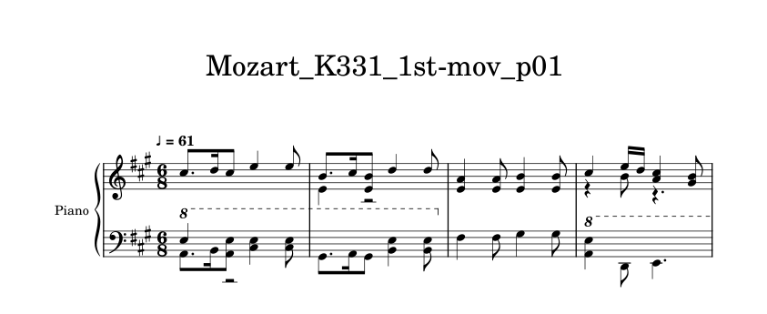](mozart-k331-p01-r1965.pdf) |
| Bach · Fuge c-Moll BWV 847 | Das Fugenthema beginnt einstimmig. Die späteren Einsätze verteilen sich auf drei Stimmen. | r1965 · 4/4 · 31 Takte · 3 Seiten |  |
| Chopin · Etüde E-Dur op. 10 Nr. 3 | Die Melodie steht über einer dicht gesetzten Begleitung. Die Ausgabe enthält einen Auftakt und vier Vorschlagsnoten. | r1965 · 2/4 · 22 Takte · 1 Seite |  |
| Schubert · Deutscher Tanz As-Dur D. 783 Nr. 15 | Der Viertelauftakt ist über den ersten Taktstrich gebunden. Die linke Hand begleitet mit Basston und nachschlagenden Akkorden. | r1965 · 3/4 · 33 Takte · 2 Seiten |  |
| Etüde Nr. 1 | Im ersten System treffen kurze Figuren im Bass auf gebundene Töne im oberen System. | r1965 · 4/4 · 18 Takte · 3 Seiten | [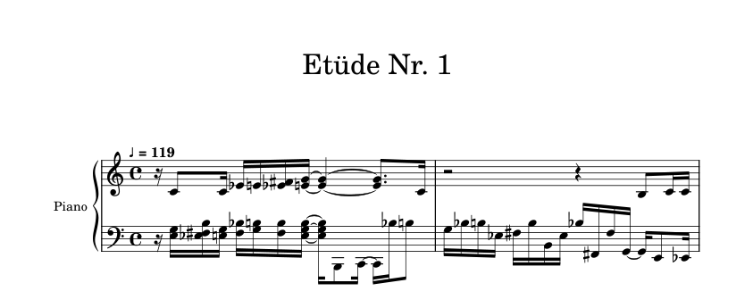](etude-1-r1965.pdf) |
| Etüde Nr. 2 | Zu Beginn ziehen sich Haltebögen durch die Oberstimme, während sich die Basslinie in kürzeren Werten bewegt. | r1965 · 4/4 · 31 Takte · 5 Seiten | [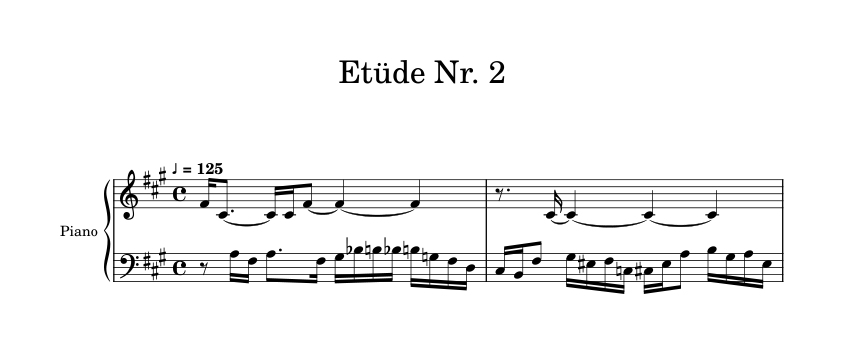](etude-2-r1965.pdf) |
| Etüde Nr. 3 | Das erste System zeigt gebundene Töne oben und kürzere Gruppen mit Pausen unten. | r1965 · 4/4 · 29 Takte · 4 Seiten | [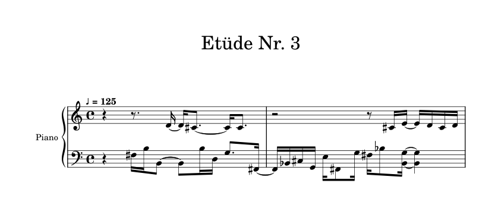](etude-3-r1965.pdf) |
| Etüde Nr. 4 | Das obere System beginnt mit Achtelgruppen. Im unteren System setzt die Begleitung nach Pausen ein. | r1965 · 4/4 · 31 Takte · 3 Seiten | [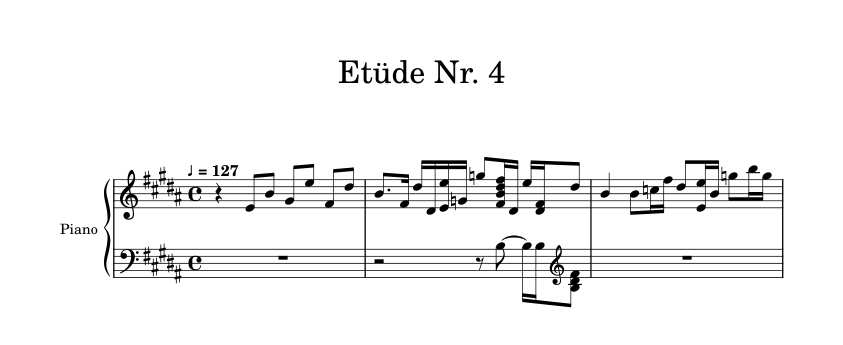](etude-4-r1965.pdf) |
| Etüde Nr. 5 | Die obere Linie steigt zunächst in Achteln an und wendet sich dann abwärts. | r1965 · 4/4 · 51 Takte · 6 Seiten | [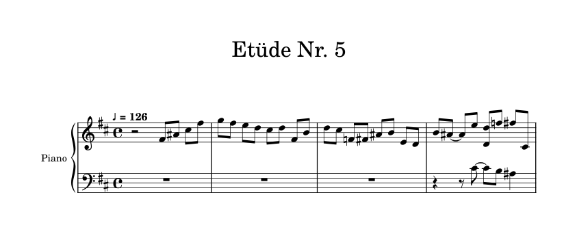](etude-5-r1965.pdf) |
| Etüde Nr. 6 | Zu Beginn folgen im oberen System kurze Notengruppen aufeinander. Später bewegen sich beide Hände gleichzeitig. | r1965 · 4/4 · 44 Takte · 6 Seiten | [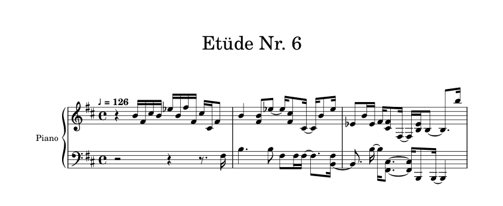](etude-6-r1965.pdf) |
| Etüde Nr. 7 | Die erste Zeile beginnt mit einer aufsteigenden Sechzehntelfigur im oberen System. | r1965 · 4/4 · 48 Takte · 6 Seiten | [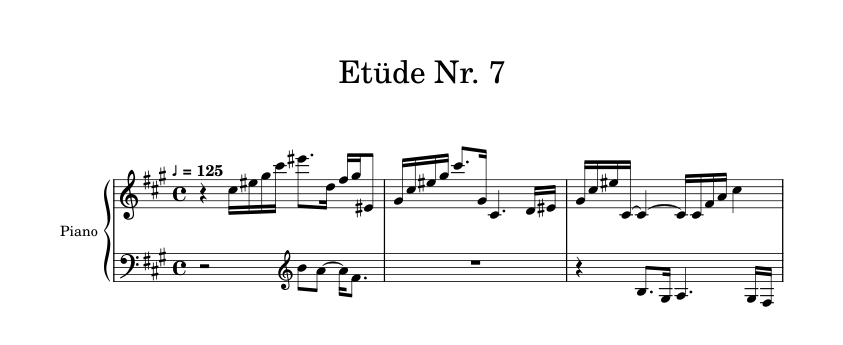](etude-7-r1965.pdf) |
| Etüde Nr. 8 | Die erste Zeile zeigt Pausentakte im oberen System. Die Bewegung liegt zunächst im Bass. | r1965 · 4/4 · 47 Takte · 6 Seiten | [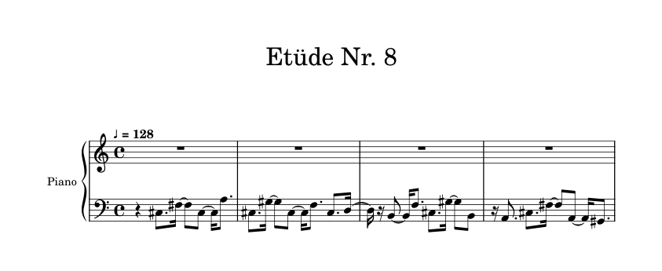](etude-8-r1965.pdf) |
| Etüde Nr. 9 | Das Stück beginnt im unteren System. Die obere Stimme setzt in der ersten Zeile mit Akkorden ein. | r1965 · 4/4 · 38 Takte · 4 Seiten | [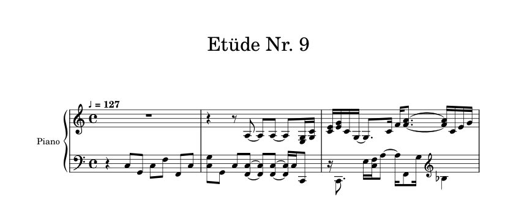](etude-9-r1965.pdf) |
| Etüde Nr. 10 | Im ersten System wechseln Akkorde und gebundene Noten. Die untere Stimme führt ihre eigene Linie. | r1965 · 4/4 · 46 Takte · 6 Seiten | [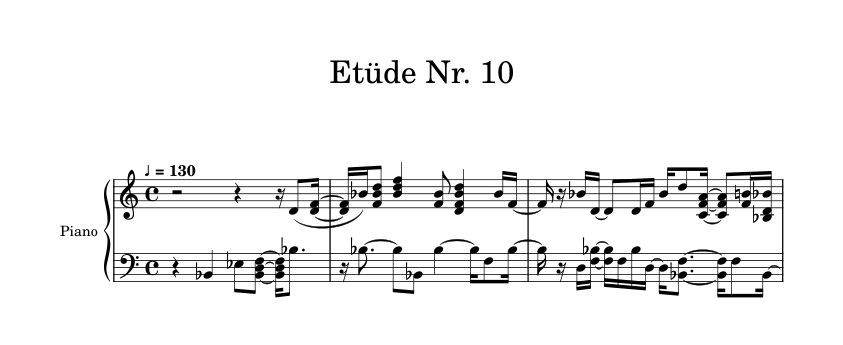](etude-10-r1965.pdf) |

### Weitere Ausgaben unter Linux

Die folgenden PDFs stammen aus zusätzlichen Einzelläufen mit MuseScore 4.7.5. Die Vorschaubilder zeigen den Anfang der jeweiligen Ausgabe.

| Stück | Eingabe und Ausgabe | Ausschnitt und PDF |
| --- | --- | --- |
| Chopin · Etüde E-Dur op. 10 Nr. 3 | Original-MIDI und WAV der Aufführung p01 aus dem Vienna 4×22 Piano Corpus. Von 448 regulären Noten stimmen alle Einsätze und Tonhöhen und 380 Dauern. Die vier Vorschlagsnoten sind separat gezählt. Master- und Render-MusicXML sind bytegleich zum Windows-Lauf r1961. r1964 und r1965 · 2/4 · 22 Takte · 1 Seite. | [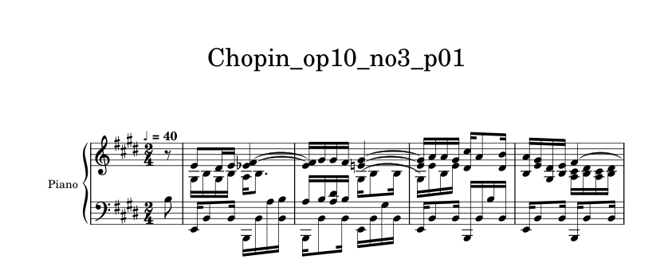](zusatzrunden/chopin-op10-no3-p01-r1964-linux.pdf) |
| Schubert · Deutscher Tanz As-Dur D. 783 Nr. 15 | Die Import-MIDI enthält die Notationszeiten, die WAV ist zeitlich ausgerichtet. Bei allen 315 regulären gespielten Referenznoten stimmen Einsatz, Tonhöhe und Dauer. In r1961 stimmten 303 dieser Dauern. r1964 und r1965 · 3/4 · 33 Takte · 2 Seiten. | [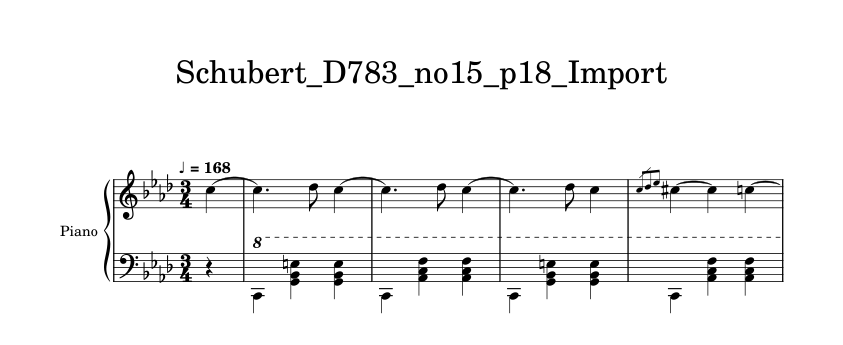](zusatzrunden/schubert-d783-no15-p18-r1964-linux.pdf) |
| Mozart · Klaviersonate A-Dur KV 331, Andante grazioso | Original-MIDI und WAV der Aufführung p01 aus dem Vienna 4×22 Piano Corpus. r1965 · 6/8 · 36 Takte · 2 Seiten. |  |

Bei allen drei Stücken stimmen die unter Linux erzeugten Master- und Render-MusicXML zwischen r1964 und r1965 bytegenau überein. Alle fünf PDF-Seiten sind bei 144 dpi pixelgleich. Für Chopin und Schubert führen die Vorschauen zu den PDFs aus r1964, für Mozart zur Ausgabe aus r1965. [Mozarts Notenbild r1965](zusatzrunden/mozart-k331-p01-r1965-linux.pdf)

[Windows-Testversion r1965 herunterladen](https://github.com/Funcry241/EtuSchlopf/releases/tag/v0.10.1839-r1965-ci-preview)

[Mozart-Einzellauf r1964](mozart-k331-p01-r1964.pdf) · [Windows-Galerie r1961](../evidence/r1961/score_sha256.tsv) · [Notenbilder r1938](../evidence/r1938/score_sha256.tsv) · [Notenbilder r1921](../evidence/r1921/score_sha256.tsv) · [Notenbilder r1886](../evidence/r1886/score_sha256.tsv)

## Frühere Notenbilder und Druckvorlagen

Klicke auf einen Ausschnitt, um das vollständige EtuSchlopf-PDF zu öffnen.

### Johann Sebastian Bach · Fuge c-Moll BWV 847

[PDF · 4 Seiten · Windows r1749](bwv847-fuge-r1749.pdf) · [Druckvorlage](https://imslp.org/wiki/Das_wohltemperierte_Klavier_I,_BWV_846-869_(Bach,_Johann_Sebastian))

### Frédéric Chopin · Etüde E-Dur op. 10 Nr. 3

[PDF · 1 Seite · Windows r1792](chopin-op10-no3-p01-r1792.pdf) · [Druckvorlage](https://github.com/CPJKU/vienna4x22/blob/master/pdf/Chopin_op10_no3.pdf)

### Franz Schubert · Deutscher Tanz As-Dur D. 783 Nr. 15

[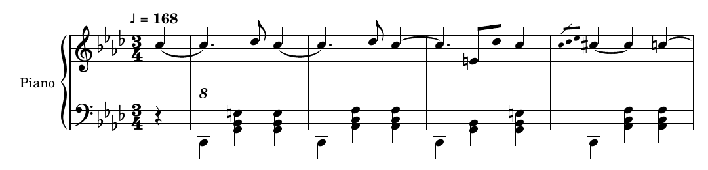](schubert-d783-no15-p18-r1872.pdf)

[PDF · 2 Seiten · Windows r1872](schubert-d783-no15-p18-r1872.pdf) · [Druckvorlage](https://imslp.org/wiki/18_German_Dances_and_Esoccaises,_D.783_(Schubert,_Franz))

#### Schubert im Vergleich

Im ersten vollen Takt setzt r1872 das E auf dem zweiten Schlag als Viertel in
den Akkord der linken Hand. Die Ausschnitte führen zum jeweiligen vollständigen PDF.

| r1871 | r1872 |
| --- | --- |
| [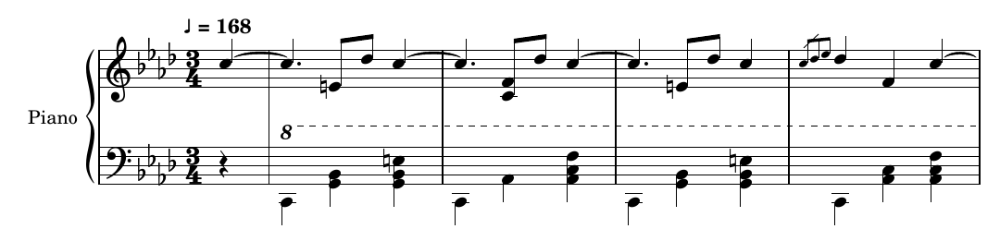](schubert-d783-no15-p18-r1871.pdf) |  |

[Windows-Abnahme und Messwerte](../evidence/r1872/README.md) · [Quelle und Lizenz der Aufführung](#schubert--deutscher-tanz-as-dur-d-783-nr-15-aufführung-p18)

## Quellen und Rechte

### Bach · Fuge c-Moll BWV 847

- **Aufnahme.** Kimiko Ishizaka, *Open Well-Tempered Clavier* (2015), Fuge Nr. 2, [CC0 1.0](https://creativecommons.org/publicdomain/zero/1.0/). Für das Referenzpaket wurde die FLAC-Aufnahme in Stereo-WAV mit 44,1 kHz und 24 Bit umgewandelt. [Veröffentlichung des Projekts](https://welltemperedclavier.org/kimiko-ishizaka-releases-open-well-tempered-clavier.html) · [Originalaufnahme](https://commons.wikimedia.org/wiki/File:Kimiko_Ishizaka_-_Bach-_Well-Tempered_Clavier,_Book_1_-_04_Fugue_No._2_in_C_minor,_BWV_847.flac).
- **MIDI.** Aus Kyle Rothers unter [CC0 1.0](https://creativecommons.org/publicdomain/zero/1.0/) veröffentlichter LilyPond-Transkription erzeugt. Die drei MIDI-Spuren bilden die geschriebenen Stimmen ab. Die MIDI verwendet Notenzeit. [IMSLP, LilyPond-Quellen Nr. 497226](https://imslp.org/wiki/Prelude_and_Fugue_in_C_minor,_BWV_847_(Bach,_Johann_Sebastian)).
- **Druckvorlage.** Bach-Gesellschaft-Ausgabe, Band 14, herausgegeben von Franz Kroll, Leipzig 1866, S. 8–9. Gemeinfrei. Das Referenzpaket enthält einen Seitenauszug. [IMSLP, Scan Nr. 173661](https://imslp.org/wiki/Das_wohltemperierte_Klavier_I,_BWV_846-869_(Bach,_Johann_Sebastian)).
- **Erzeugter Notensatz.** [EtuSchlopf-PDF r1749](bwv847-fuge-r1749.pdf) · [Ausschnitt](../images/bwv847-fuge-r1749-ausschnitt.png).

### Chopin · Etüde E-Dur op. 10 Nr. 3, Aufführung p01

- **Aufnahme und MIDI.** Werner Goebl, *The Vienna 4×22 Piano Corpus*, Version 1.0 (2017), mdw – Universität für Musik und darstellende Kunst Wien. Die Originaldateien `Chopin_op10_no3_p01.wav` und `Chopin_op10_no3_p01.mid` sind als Referenzpaar unverändert. [Datensatz, DOI 10.21939/4X22](https://doi.org/10.21939/4X22) · [CC BY 4.0](https://creativecommons.org/licenses/by/4.0/).
- **Notationszuordnung.** EtuSchlopf hat die Tabelle aus `match/Chopin_op10_no3_p01.match` berechnet. Die Ausgangsdatei stammt aus der vom Institute of Computational Perception der Johannes Kepler Universität Linz aktualisierten Zuordnung. Für die Tabelle wurde ein vorhandener E3-Anschlag einem als ausgelassen markierten Notenereignis zugeordnet. Vier Vorschläge wurden mit ihrer jeweiligen Hauptnote verknüpft. [Quelle der Zuordnung](https://github.com/CPJKU/vienna4x22/blob/master/match/Chopin_op10_no3_p01.match) · [CC BY 4.0 für die Korpusdaten, Aktualisierungen und die abgeleitete Tabelle](https://creativecommons.org/licenses/by/4.0/).
- **Druckvorlage.** Das verwendete Referenz-PDF ist bytegleich mit der PDF-Datei im CPJKU-Repository (Git-Blob `f339e12c4871d6369ab94b97e36d8e60c6b91c31`). Das Änderungsprotokoll dokumentiert gemeinfreie IMSLP-Scans als Quelle. Die konkrete Druckausgabe bleibt offen. [Referenz-PDF im Korpus](https://github.com/CPJKU/vienna4x22/blob/master/pdf/Chopin_op10_no3.pdf) · [Herkunft der Scans](https://github.com/CPJKU/vienna4x22/blob/master/CHANGES.md#04112019).
- **Erzeugter Notensatz.** Das PDF und sein Vorschaubild zeigen die von EtuSchlopf verarbeitete Aufführung p01. Die Namensnennung und Lizenzlinks für die zugrunde liegende Einspielung stehen oben. [EtuSchlopf-PDF r1792](chopin-op10-no3-p01-r1792.pdf) · [Ausschnitt](../images/chopin-op10-no3-p01-r1792-ausschnitt.png).

### Mozart · Klaviersonate A-Dur KV 331, Andante grazioso, Einspielung p01

**Mozart, Klaviersonate A-Dur KV 331, Andante grazioso, Einspielung p01.** Quelle der Performance-MIDI und WAV ist Werner Goebl, *The Vienna 4×22 Piano Corpus*, Version 1.0 (2017), mdw – Universität für Musik und darstellende Kunst Wien. [Datensatz](https://doi.org/10.21939/4X22) · [CC BY 4.0](https://creativecommons.org/licenses/by/4.0/). EtuSchlopf hat daraus den Notensatz und dessen Vorschaubild erzeugt. Die unveränderte MIDI und WAV der mdw bilden die Eingaben. [EtuSchlopf-PDF r1965](mozart-k331-p01-r1965.pdf) · [Vorschau](../images/mozart-k331-p01-r1965-ausschnitt.png).

### Schubert · Deutscher Tanz As-Dur D. 783 Nr. 15, Aufführung p18

- **Aufnahme, MIDI und Zuordnung.** Werner Goebl, *The Vienna 4×22 Piano Corpus*, Version 1.0 (2017), mdw – Universität für Musik und darstellende Kunst Wien. Die Zuordnungsdatei nennt C. Zeilinger als Interpret. Die Audio-Onset-Liste nennt Siying Wang als Annotatorin. [Datensatz, DOI 10.21939/4X22](https://doi.org/10.21939/4X22) · [CC BY 4.0](https://creativecommons.org/licenses/by/4.0/).
- **Bearbeitungen für den Import.** Die Import-MIDI ergänzt Taktart, Tonart und Tempoverlauf und bindet Auftakt und Notationszeiten. Sie kennzeichnet Vorschläge und reine Wiedergabeereignisse. Die WAV-Arbeitsfassung wurde zeitlich ausgerichtet. Dazu wurde der Vorlauf gekürzt und Stille für die leeren Auftaktviertel vorangestellt.
- **Druckvorlage.** Franz Schubert, *Deutsche Tänze und Ecossaisen*, herausgegeben von Julius Epstein, Breitkopf & Härtel, Leipzig 1889, Platte F.S. 126. Nr. 15 steht unten auf PDF-Seite 5 und oben auf Seite 6. Gemeinfrei. [IMSLP, Scan Nr. 03143](https://imslp.org/wiki/18_German_Dances_and_Esoccaises,_D.783_(Schubert,_Franz)).
- **Erzeugter Notensatz.** Das EtuSchlopf-PDF aus dem Windows-Lauf r1872 basiert auf der für den Import bearbeiteten Aufführung p18. Die Namensnennung und Lizenzlinks für das Ausgangsmaterial stehen oben. [EtuSchlopf-PDF r1872](schubert-d783-no15-p18-r1872.pdf).

### Chopin · Ballade Nr. 2 F-Dur op. 38, Andantino, Aufführung p01

Der zurückgestellte Stresstest umfasst das Andantino bis zum Schlussakkord. Die Ballade liegt außerhalb der Vollkorpus-Abnahme. Original-MIDI und Original-WAV derselben Aufführung stehen unter CC BY 4.0. Als Vergleich dient die deutsche Erstausgabe von 1840. [Dateien, Namensnennung, Prüfsummen und Druckvorlage](chopin-op38-p01.md).

## Weitergabe

Bei der Weitergabe von Material unter CC BY 4.0 gehören die Namensnennung, die Quelle, der Lizenzlink und ein Hinweis auf Bearbeitungen zum Paket. Bereits vorhandene Lizenz- und Änderungshinweise bleiben erhalten. Das gilt auch, wenn die Referenzdateien einzeln weitergegeben werden. [Lizenzbedingungen, Abschnitt 3](https://creativecommons.org/licenses/by/4.0/legalcode).
