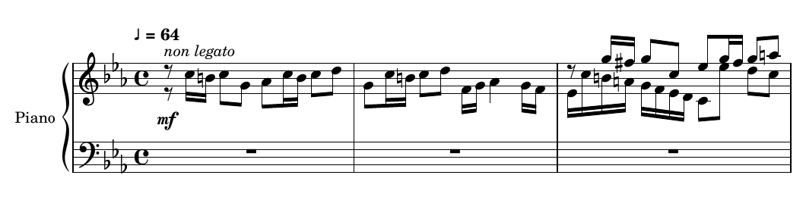
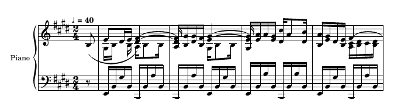

# Musikreferenzen und Lizenzhinweise

Hier stehen die Quellen und Rechte der drei Musikreferenzen von EtuSchlopf. Die [Fremdlizenzhinweise zum Programm](../THIRD_PARTY_NOTICES.md) führen zu dieser Seite. Für die Referenzdateien gelten die unten genannten Rechte und Lizenzen.

## Notenbilder

Die folgenden PDFs stammen aus dem Windows-Korpuslauf r1886. Die Namensnennungen zu Bach, Chopin und Schubert stehen unter [Quellen und Rechte](#quellen-und-rechte).

| Stück | Seiten | PDF |
| --- | ---: | --- |
| Bach · Fuge c-Moll BWV 847 | 3 | [PDF](bwv847-fuge-r1886.pdf) |
| Chopin · Etüde E-Dur op. 10 Nr. 3 | 1 | [PDF](chopin-op10-no3-p01-r1886.pdf) |
| Schubert · Deutscher Tanz As-Dur D. 783 Nr. 15 | 2 | [PDF](schubert-d783-no15-p18-r1886.pdf) |
| Etüde Nr. 1 | 2 | [PDF](etude-1-r1886.pdf) |
| Etüde Nr. 2 | 5 | [PDF](etude-2-r1886.pdf) |
| Etüde Nr. 3 | 4 | [PDF](etude-3-r1886.pdf) |
| Etüde Nr. 4 | 3 | [PDF](etude-4-r1886.pdf) |
| Etüde Nr. 5 | 6 | [PDF](etude-5-r1886.pdf) |
| Etüde Nr. 6 | 6 | [PDF](etude-6-r1886.pdf) |
| Etüde Nr. 7 | 6 | [PDF](etude-7-r1886.pdf) |
| Etüde Nr. 8 | 6 | [PDF](etude-8-r1886.pdf) |
| Etüde Nr. 9 | 4 | [PDF](etude-9-r1886.pdf) |
| Etüde Nr. 10 | 6 | [PDF](etude-10-r1886.pdf) |

## Frühere Notenbilder und Druckvorlagen

Klicke auf einen Ausschnitt, um das vollständige EtuSchlopf-PDF zu öffnen.

### Johann Sebastian Bach · Fuge c-Moll BWV 847

[PDF · 4 Seiten · Windows r1749](bwv847-fuge-r1749.pdf) · [Druckvorlage](https://imslp.org/wiki/Das_wohltemperierte_Klavier_I,_BWV_846-869_(Bach,_Johann_Sebastian))

### Frédéric Chopin · Etüde E-Dur op. 10 Nr. 3

[PDF · 1 Seite · Windows r1792](chopin-op10-no3-p01-r1792.pdf) · [Druckvorlage](https://github.com/CPJKU/vienna4x22/blob/master/pdf/Chopin_op10_no3.pdf)

### Franz Schubert · Deutscher Tanz As-Dur D. 783 Nr. 15

[PDF · 2 Seiten · Windows r1872](schubert-d783-no15-p18-r1872.pdf) · [Druckvorlage](https://imslp.org/wiki/18_German_Dances_and_Esoccaises,_D.783_(Schubert,_Franz))

#### Schubert im Vergleich

Im ersten vollen Takt setzt r1872 das E auf dem zweiten Schlag als Viertel in
den Akkord der linken Hand. Die Ausschnitte führen zum jeweiligen vollständigen PDF.

| r1871 | r1872 |
| --- | --- |
|  |  |

[Windows-Abnahme und Messwerte](../evidence/r1872/README.md) · [Quelle und Lizenz der Aufführung](#schubert--deutscher-tanz-as-dur-d-783-nr-15-aufführung-p18)

## Quellen und Rechte

### Bach · Fuge c-Moll BWV 847

- **Aufnahme.** Kimiko Ishizaka, *Open Well-Tempered Clavier* (2015), Fuge Nr. 2, [CC0 1.0](https://creativecommons.org/publicdomain/zero/1.0/). Für das Referenzpaket wurde die FLAC-Aufnahme in Stereo-WAV mit 44,1 kHz und 24 Bit umgewandelt. [Veröffentlichung des Projekts](https://welltemperedclavier.org/kimiko-ishizaka-releases-open-well-tempered-clavier.html) · [Originalaufnahme](https://commons.wikimedia.org/wiki/File:Kimiko_Ishizaka_-_Bach-_Well-Tempered_Clavier,_Book_1_-_04_Fugue_No._2_in_C_minor,_BWV_847.flac).
- **MIDI.** Aus Kyle Rothers unter [CC0 1.0](https://creativecommons.org/publicdomain/zero/1.0/) veröffentlichter LilyPond-Transkription erzeugt. Die drei MIDI-Spuren bilden die geschriebenen Stimmen ab. Die MIDI verwendet Notenzeit. [IMSLP, LilyPond-Quellen Nr. 497226](https://imslp.org/wiki/Prelude_and_Fugue_in_C_minor,_BWV_847_(Bach,_Johann_Sebastian)).
- **Druckvorlage.** Bach-Gesellschaft-Ausgabe, Band 14, herausgegeben von Franz Kroll, Leipzig 1866, S. 8–9. Gemeinfrei. Das Referenzpaket enthält einen Seitenauszug. [IMSLP, Scan Nr. 173661](https://imslp.org/wiki/Das_wohltemperierte_Klavier_I,_BWV_846-869_(Bach,_Johann_Sebastian)).
- **Erzeugter Notensatz.** [EtuSchlopf-PDF r1749](bwv847-fuge-r1749.pdf) · [Ausschnitt](../images/bwv847-fuge-r1749-ausschnitt.png).

### Chopin · Etüde E-Dur op. 10 Nr. 3, Aufführung p01

- **Aufnahme und MIDI.** Werner Goebl, *The Vienna 4×22 Piano Corpus*, Version 1.0 (2017), mdw – Universität für Musik und darstellende Kunst Wien. Die Originaldateien `Chopin_op10_no3_p01.wav` und `Chopin_op10_no3_p01.mid` sind als Referenzpaar unverändert. [Datensatz, DOI 10.21939/4X22](https://doi.org/10.21939/4X22) · [CC BY 4.0](https://creativecommons.org/licenses/by/4.0/).
- **Notationszuordnung.** EtuSchlopf hat die Tabelle aus `match/Chopin_op10_no3_p01.match` berechnet. Die Ausgangsdatei stammt aus der vom Institute of Computational Perception der Johannes Kepler Universität Linz aktualisierten Zuordnung. Für die Tabelle wurde ein vorhandener E3-Anschlag einem als ausgelassen markierten Notenereignis zugeordnet. Vier Vorschläge wurden mit ihrer jeweiligen Hauptnote verknüpft. [Quelle der Zuordnung](https://github.com/CPJKU/vienna4x22/blob/master/match/Chopin_op10_no3_p01.match) · [CC BY 4.0 für die Korpusdaten, Aktualisierungen und die abgeleitete Tabelle](https://creativecommons.org/licenses/by/4.0/).
- **Druckvorlage.** Das verwendete Referenz-PDF ist bytegleich mit der PDF-Datei im CPJKU-Repository (Git-Blob `f339e12c4871d6369ab94b97e36d8e60c6b91c31`). Das Änderungsprotokoll dokumentiert gemeinfreie IMSLP-Scans als Quelle. Die konkrete Druckausgabe bleibt offen. [Referenz-PDF im Korpus](https://github.com/CPJKU/vienna4x22/blob/master/pdf/Chopin_op10_no3.pdf) · [Herkunft der Scans](https://github.com/CPJKU/vienna4x22/blob/master/CHANGES.md#04112019).
- **Erzeugter Notensatz.** Das PDF und sein Vorschaubild zeigen die von EtuSchlopf verarbeitete Aufführung p01. Die Namensnennung und Lizenzlinks für die zugrunde liegende Einspielung stehen oben. [EtuSchlopf-PDF r1792](chopin-op10-no3-p01-r1792.pdf) · [Ausschnitt](../images/chopin-op10-no3-p01-r1792-ausschnitt.png).

### Schubert · Deutscher Tanz As-Dur D. 783 Nr. 15, Aufführung p18

- **Aufnahme, MIDI und Zuordnung.** Werner Goebl, *The Vienna 4×22 Piano Corpus*, Version 1.0 (2017), mdw – Universität für Musik und darstellende Kunst Wien. Die Zuordnungsdatei nennt C. Zeilinger als Interpret. Die Audio-Onset-Liste nennt Siying Wang als Annotatorin. [Datensatz, DOI 10.21939/4X22](https://doi.org/10.21939/4X22) · [CC BY 4.0](https://creativecommons.org/licenses/by/4.0/).
- **Bearbeitungen für den Import.** Die Import-MIDI ergänzt Taktart, Tonart und Tempoverlauf und bindet Auftakt und Notationszeiten. Sie kennzeichnet Vorschläge und reine Wiedergabeereignisse. Die WAV-Arbeitsfassung wurde zeitlich ausgerichtet. Dazu wurde der Vorlauf gekürzt und Stille für die leeren Auftaktviertel vorangestellt.
- **Druckvorlage.** Franz Schubert, *Deutsche Tänze und Ecossaisen*, herausgegeben von Julius Epstein, Breitkopf & Härtel, Leipzig 1889, Platte F.S. 126. Nr. 15 steht unten auf PDF-Seite 5 und oben auf Seite 6. Gemeinfrei. [IMSLP, Scan Nr. 03143](https://imslp.org/wiki/18_German_Dances_and_Esoccaises,_D.783_(Schubert,_Franz)).
- **Erzeugter Notensatz.** Das EtuSchlopf-PDF aus dem Windows-Lauf r1872 basiert auf der für den Import bearbeiteten Aufführung p18. Die Namensnennung und Lizenzlinks für das Ausgangsmaterial stehen oben. [EtuSchlopf-PDF r1872](schubert-d783-no15-p18-r1872.pdf).

## Weitergabe

Bei der Weitergabe von Material unter CC BY 4.0 gehören die Namensnennung, die Quelle, der Lizenzlink und ein Hinweis auf Bearbeitungen zum Paket. Bereits vorhandene Lizenz- und Änderungshinweise bleiben erhalten. Das gilt auch, wenn die Referenzdateien einzeln weitergegeben werden. [Lizenzbedingungen, Abschnitt 3](https://creativecommons.org/licenses/by/4.0/legalcode).
